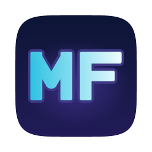
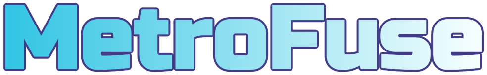

<p align="center">
  
</p>

<p align="center">
  
</p>

<p align="center">
  Play <b>Metroid Fusion</b> natively on macOS, Windows and Linux.
</p>

<p align="center">
  <a href="https://github.com/sweatyeggs69/MetroFuse/actions/workflows/build.yml"></a>
  <a href="LICENSE"></a>
  
</p>

> [!IMPORTANT]
> MetroFuse does not include the game. You need your own legally dumped ROM of
> **Metroid Fusion (USA)**, which MetroFuse checks before playing.
> MetroFuse is an unofficial fan project. It is not affiliated with, endorsed or sponsored by
> Nintendo. Metroid and all related names are trademarks of their respective owners.

### Works with RecompLauncher

KNID works with [RecompLauncher](https://recomplauncher.com), which installs and updates it from
these releases. Pick your ROM there and it is checked against the verified USA dump, set as KNID's
game, and started with Play. The display settings show on the game's page too.

[](https://recompstore.com/dev/sweatyeggs69)

## Features

- **Native on macOS, Windows and Linux**, with smooth, tear-free video and sound.
- **Themed launcher** with **Continue** to pick up where you left off.
- **One settings menu (F1)** for display (scaling, widescreen, screen effects) and controls.
- **Controllers and remapping** for keyboard and gamepads.
- **Save states**: ten slots plus Auto, with thumbnails, quick save/load and optional auto-load.
- **Cheats** (F1 > Cheats/Mods): unlimited health, missiles and power bombs. Off in RetroAchievements hardcore mode.
- **Redux Mode** (F1 > Cheats/Mods): optional quality-of-life tweaks, switched on together or one at a time: skip the
  opening with START, fast text, faster doors and elevators, item counts and timer on the map, an accurate clock, a
  chargeable starting beam, a Morph Ball that rests when still, and no low health alarm. Inspired by
  [Metroid Fusion Redux](https://github.com/ShadowOne333/Metroid-Fusion-Redux) by ShadowOne333 and the community hacks
  it collects; these are MetroFuse's own versions for the USA game, applied in memory (your ROM file is never changed).
  Off in RetroAchievements hardcore mode.
- **Import saves** from RetroArch, mGBA, VBA-M and others.
- **RetroAchievements**, optional.
- **Automatic updates** from this repository's releases, with your OK, without touching your saves.
- **Optional BIOS** with the original boot animation (not required).

## Controls

Defaults; change them in Settings > Controls.

| Action | Keyboard | Gamepad |
| --- | --- | --- |
| D-pad | Arrow keys | D-pad or left stick |
| A / B | X / Z | South / East (also North / West) |
| L / R | A / S | Shoulders or triggers |
| Start / Select | Enter / Backspace | Start / Back |
| Settings menu | F1 or Esc | |
| Quick save / load | Page Up / Page Down | Back + R / Back + L |
| Save to new slot | F9 | |
| Previous / next slot | F6 / F7 | Back + D-pad left / right |
| Fullscreen | F11 | |

Settings > Controls > Extra controls adds optional buttons, all unbound until you set them:

- **Missile toggle**: press once to arm missiles, press again to go back to the beam (instead of
  holding R). In morph ball it arms power bombs, the same as holding R.
- **Aim diagonally up / down**: hold to aim, instead of holding L (and L + Down).
- **Right stick aims diagonally**: push the right stick up or down to aim.

START already opens the map in Fusion, so there is no separate map button.

Any button a controller reports can be bound, including paddles, back buttons, extra buttons,
D-pads on arcade sticks, and mouse buttons 4 and 5. Controllers SDL has no layout for are read
as raw joysticks, so their buttons show up by number. Buttons remapped by Steam Input or another
remapper work as whatever key or button they send.

Quick save and quick load use the Auto slot until you pick another slot (F6 / F7, or click a slot in
the States tab). Closing the game also saves to the Auto slot.

## FAQ

**Which version of the game is supported?**
Metroid Fusion, USA release (game code `AMTE`, revision 0).

**Do I need a GBA BIOS?**
No. MetroFuse has a built-in replacement. If you own a BIOS dump, Settings > Game > BIOS shows the
original boot animation.

**Where are my saves?**
In your user folder, never inside the app: `~/Library/Application Support/MetroFuse/MetroFuse/`
(macOS), `%APPDATA%\MetroFuse\MetroFuse\` (Windows) or `~/.local/share/MetroFuse/MetroFuse/`
(Linux).

<details>
<summary><b>Building from source</b></summary>

You need CMake 3.24+, a C++20 compiler and Git. SDL3, Dear ImGui and rcheevos are fetched
automatically.

```sh
cmake -S . -B build -G Ninja -DCMAKE_BUILD_TYPE=Release -DMETROFUSE_VENDOR_SDL=ON
cmake --build build
ctest --test-dir build --output-on-failure
./build/metrofuse
```

- **macOS app and DMG:** add `-DMETROFUSE_MACOS_BUNDLE=ON "-DCMAKE_OSX_ARCHITECTURES=arm64;x86_64"`
  and build the `dmg` target.
- **Windows:** Visual Studio 2022; `vcpkg install zlib:x64-windows-static` and pass the vcpkg
  toolchain with `-DVCPKG_TARGET_TRIPLET=x64-windows-static -DMETROFUSE_PACKAGE=ON`, then build
  `package_exe`.
- **Linux:** install the SDL build dependencies (X11/Wayland, ALSA/PulseAudio, `zlib1g-dev`); see
  `.github/workflows/build.yml` for the full list.
- **Analysis tools:** `metrofuse_disasm` (needs Capstone) traces the ROM into `generated/`, which
  is gitignored. Its output is derived from the game and must never be committed.

Tests that need the game look for `Metroid Fusion.gba` in the source folder (or `$METROFUSE_ROM`)
and skip themselves otherwise. Never commit ROMs, BIOS files, saves, states or screenshots of the
game.

</details>

<details>
<summary><b>For maintainers</b></summary>

- **Releases:** bump `VERSION` in `project(metrofuse ...)` in `CMakeLists.txt`, then push a matching
  tag like `v1.0.0`. GitHub Actions builds all three platforms and publishes the release. Keep the
  file names (`MetroFuse-<version>-macOS.dmg`, `MetroFuse-<version>-Windows-x64.exe`,
  `MetroFuse-<version>-Linux-x64.AppImage`, `SHA256SUMS.txt`); the in-app updater looks for them.

</details>

## Contributing

Bug reports and pull requests are welcome. Keep game content out of the repository: no ROMs, BIOS
files, saves, save states, extracted assets or screenshots of the game.

## License

[MIT](LICENSE). Bundled open-source components and fonts are listed in
[THIRD_PARTY_NOTICES.md](THIRD_PARTY_NOTICES.md).
